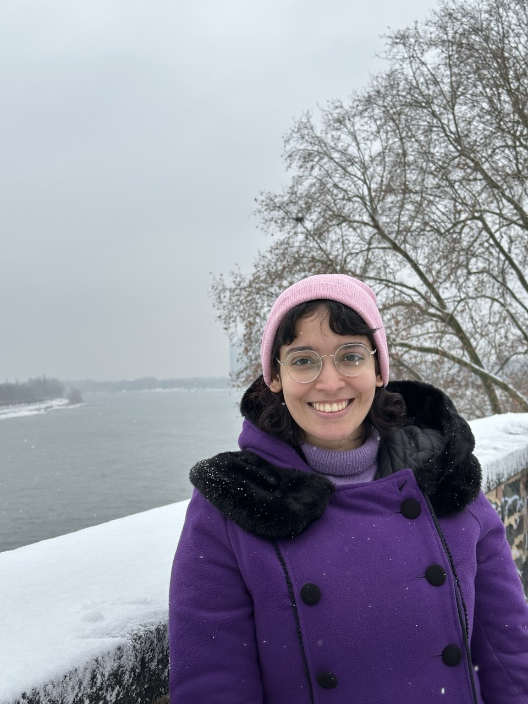

  <a href="/">Home</a> &nbsp;|&nbsp; 
  <a href="/research.html">Research</a> &nbsp;|&nbsp; 
  <a href="/publications.html">Publications</a> &nbsp;|&nbsp; 
  <a href="/cvpdf.html">CV</a> &nbsp;|&nbsp;
  <a href="/about.html">Trivia</a>

---

# Hello, I'm Toka! 👋

  

    

      I am currently doing my PhD in Astrophysics at the Argelander-Institut für Astronomie, University of Bonn. 
      I am also a member of the <a href="https://blog.mpifr-bonn.mpg.de/imprs/">IMPRS for Astronomy & Astrophysics</a>, 
      and the Bonn-Cologne Graduate School for Physics and Astronomy (<a href="https://www.gradschool.physics.uni-bonn.de/">BCGS</a>).
      My research is funded by the <a href="https://dynaverse.astro.uni-koeln.de/">DFG cluster of excellence "Our Dynamic Universe"</a>.
    

    

      My research focuses on using numerical simulations, statistics, and machine learning methods to:
    

    <ul>
      <li>Improve our understanding of the relationship between the early universe and the large-scale structure (cosmic web).</li>
      <li>Develop new methods to boost the data analysis of future galaxy redshift surveys.</li>
    </ul>
  

  

    
  

---

  I will be applying for postdoctoral positions starting this fall, hoping to embark on my next quest in late 2027/early 2028! Please feel free to reach out to regarding any possible opportunities or collaborations.

---

## News & Updates

<ul style="list-style-type: none; padding-left: 0; line-height: 1.6;">
  <li style="margin-bottom: 12px;">
  <strong style="color: #555;">[Oct. 2026]</strong> 🎉 My recent paper on frequentist tests of SBI for primordial non-Gaussianity is now officially <a href="https://www.aanda.org/articles/aa/full_html/2026/10/aa60668-26/aa60668-26.html" target="_blank">published in A&A</a>!
  </li>
  <li style="margin-bottom: 12px;">
    <strong style="color: #555;">[Sep. 2026]</strong> 🗣️ Gave two contributed talks at the <em>2026 AG meeting</em> in Garching bei München + started posting self-made astronomy webcomics on <a href="https://www.instagram.com/tokaalokda/" target="_blank">instagram</a>!
  </li>
  <li style="margin-bottom: 12px;">
    <strong style="color: #555;">[Aug. 2026]</strong> My second paper got accepted in A&A! + I presented a poster at the "New Frontiers in Cosmology" conference in A Coruña, got exposed to lots of great science, and saw the total solar eclipse!
  </li>
  <li style="margin-bottom: 12px;">
    <strong style="color: #555;">[June 2026]</strong> I presented a contributed talk in the "Advancing Field-level and Simulation-based Inference for Cosmology" conference, which was held in the Perimeter Institute in Canada. I am grateful for the organizers, who ran a smooth hybrid format and gave me an exception in the last minute to virtually present my work, as my visa was delayed for some weeks.
  </li>
  <li style="margin-bottom: 12px;">
    <strong style="color: #555;">[May 2026]</strong> I attended the Cosmoverse training school in Sofia, learned the necessary workflow to participate in the Cosmoverse data challenge, and presented a lightning talk on my PhD work!
  </li>
  <li style="margin-bottom: 12px;">
    <strong style="color: #555;">[Apr. 2026]</strong> <a href="https://arxiv.org/abs/2605.00980" target="_blank">I just submitted my second paper!</a> + started my new blog column: <a href="https://singularit.home.blog/taking-up-space-posts-from-the-phd-trenches/" target="_blank">"Taking up space: Life in the PhD trenches"</a>, to document the second leg of my PhD!
  </li>
</ul>

---

## Contact

*email:* toka(at)uni-bonn.de

[INSPIRE](https://inspirehep.net/authors/2957898) | [BlueSky](https://bsky.app/profile/astrotoka.bsky.social) | [LinkedIn](https://www.linkedin.com/in/tokaalokda) | [Github](https://github.com/tokaalokda) | [Blog](https://singularit.home.blog/)
